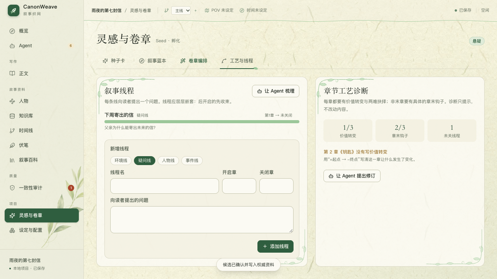

# CanonWeave · 叙事织网

> Keep every story whole.

CanonWeave 是一个本地优先的长篇叙事创作工具。它帮助作者管理人物、事实、时间线、关系和伏笔，并在 AI 生成前后检查设定冲突、人物声音与文笔漂移。

所有项目数据保存在本地 SQLite 中。模型输出、旧稿抽取和对话建议都先进入候选区，只有确认后才会成为正式事实。


## 功能

- **灵感与卷章**：从一句话生成三种走向；章节总数、卷数和每卷章节数均由作者定义。
- **旧稿导入**：导入 TXT、Markdown、DOCX，按章节切分并抽取待确认事实。
- **叙事正典**：维护人物、地点、世界规则、事实、关系、事件和双时间线。
- **知识域**：环境、重要物品与作者自建的禁墟、神道、灾厄等专题知识库，支持自定义字段。
- **章节写作**：默认按章写作；只有需要多地点、多视角或多时间点时才拆分场次。
- **写作 Agent**：像编码 Agent 管理仓库一样管理故事。模型通过工具调用自主浏览项目虚拟目录（`/人物/林澈`、`/章节/3`、`/线程` …）、检索原文、诊断章节工艺、运行一致性巡检，再把修改整理成候选；“规划”模式只读，“执笔”模式可提出候选。输入 `@路径` 引用资料，关键取舍会以选项卡交还作者。
- **分层故事圣经**：叙事蓝本默认按“史诗级”分层构建——世界规律与能力体系（多阶位、代价、边界、克制）→ 势力格局（含中立方与隐藏势力）→ 人物群像（含明暗对手与动机）→ 总体结构与对手暗线 → 漏洞审查，再编织因果链；会保留作者已确认的人物与知识条目。确认后可让 Agent 把蓝本落入人物页、知识库（势力组织、能力体系、世界规则、环境、物品）与时间线。
- **创作流水线**：概览页按“创作契约 → 作者守则 → 故事圣经地基 → 因果主线 → 卷章骨架 → 章节工艺卡 → 正文起草 → 审计与修订”推导当前阶段，每一步都可以自己动手或交给 Agent。
- **章节工艺卡与叙事线程**：每章记录价值转变（如 `+信任 → -猜疑`）、两难抉择、章末钩子与读者揭示；环境/疑问/人物/事件四类线程按“先开后关”检查嵌套收束。
- **作者守则**：项目级长期写作规则（视角纪律、禁写内容、命名约定、文风红线），每轮 Agent 对话都会先读取。
- **可选混合检索**：关闭时使用 FTS5 + PPR；开启 OpenAI 兼容 Embedding 后，按内容哈希增量建索引，并用 RRF 融合全文、向量与图谱召回。
- **一致性审计**：SQL 规则与内置时间约束求解器（简单时间网络，负环即冲突核心）检查硬约束，返回来源证据和最小冲突核心。
- **风险审核**：L0-L3 分级、审核策略、批量确认、抽样复核和整批撤销。
- **人物声音**：用作者样本建立人物声音质心，定位台词和 POV 漂移片段。
- **叙事文笔**：七种预设、六维调节、作者样本校准和 A/B 本地偏好。
- **图谱与百科**：双时间线、关系图、分层社区、PPR 子图问答和可重建 Narrative Wiki；模型摘要必须携带来源 ID。
- **伏笔管理**：记录埋设、推进和兑现契约，兑现必须有原文与状态变化证据。
- **版本与导出**：正文快照、版本回滚，以及 Markdown、DOCX 导出。

| 写作 Agent | 工艺与线程 |
| --- | --- |
|  |  |

| 正文工坊 | 叙事图谱 |
| --- | --- |
|  |  |

| 知识库 | Multi-view 卷章 |
| --- | --- |
|  |  |

| Narrative Wiki | 项目导出 |
| --- | --- |
|  |  |

> 截图使用测试项目数据，仅用于展示界面。

## 快速启动

需要 Node.js 20.19+ 或 22.12+、Rust 1.77+，以及 Tauri 对应的系统依赖。

### macOS

双击：

```text
CanonWeave.command
```

或在终端运行：

```bash
./quick-start.sh
```

### Windows

双击：

```text
CanonWeave.cmd
```

或在 PowerShell 中运行：

```powershell
.\quick-start.ps1
```

启动工具会自动检查 Node/Rust、缺少依赖时执行 `npm install`，然后打开桌面应用。

其他启动方式：

```bash
npm start                   # 已安装依赖时直接启动
./quick-start.sh --web      # 浏览器界面预览
./quick-start.sh --build    # 构建发行版
./quick-start.sh --install  # 只检查环境并安装依赖
```

浏览器预览不包含 Tauri、SQLite 和系统钥匙串功能，正常使用请启动桌面应用。

### macOS 开发签名

`tauri dev` 的临时二进制每次重新链接后都会获得新的 ad-hoc 代码哈希，macOS 会因此再次要求授权读取 API Key。需要频繁联调模型时，可创建一次本地签名身份，并使用稳定签名的调试应用：

```bash
npm run macos:setup-signing  # 每个 macOS 用户执行一次
npm run dev:macos            # 重新构建、稳定签名并打开调试应用
```

应用启动和打开设置页都不会再读取 Key；普通启动即使不做稳定签名，也只会在第一次真正调用模型时请求钥匙串权限。

首次读取 Key 时在系统对话框中选“始终允许”，后续重新构建仍会复用同一代码签名身份。签名私钥与信任证书只写入 macOS 钥匙串，临时证书文件会在脚本结束时删除，不会进入仓库。

## 第一次使用

1. 在“设定与配置 → 模型”中填写 OpenAI 兼容接口的 Base URL、API Key 和模型名。
2. 点击“测试连接”。API Key 会保存到系统钥匙串。
3. 选择一个空目录，创建新项目，或打开已有项目。
4. 选择“从一句话开始”“导入旧稿”或“两者都有”。

Base URL 可以填写 API 根地址，例如：

```text
https://api.openai.com/v1
```

## 基本流程

### 1. 建立故事骨架

进入“灵感与卷章”，输入一句话并生成三种走向。确认种子卡后，可以选择单卷直排并填写章节总数，也可以逐卷填写卷名和每卷章节数。大型结构会分批生成，避免一次输出被截断。

### 2. 导入或补全资料

在“设定与配置 → 旧稿导入”导入已有稿件，或通过人物、知识库、时间线和伏笔页面补全项目资料。

导入和抽取产生的内容都会先进入“审计”候选区。

### 3. 建立人物、知识域与文笔

人物页记录欲望、缺陷、秘密和声音样本；知识库内置“环境”和“重要物品”，也可以建立“禁墟”“神道”“灾厄”等自定义知识域。自建知识条目会自动成为图谱实体，并参与检索、上下文编译与 Wiki。

### 4. 按章生成正文

进入“正文”选择章节并建立本章写作任务，填写目标、冲突、POV、地点、情绪节拍与母题。普通单线章节不需要先设计场景；需要多地点、多视角或时间跳转时，再打开“分场编辑”。

可以先查看上下文预检，再选择：

- 快速：直接起草
- 精修：起草后润色，并检查硬事实变化

生成内容先进入草稿候选，接受后才写入正文版本。

### 5. 审核设定变化

在“审计”中处理人物、事实、关系和伏笔候选。

- L0/L1 可按策略批量处理
- L2 需要单条确认
- L3 硬冲突必须人工处理

### 6. 使用 Agent 从灵感推进到正文

- 用自然语言下达任务即可，例如“我想写一个……的故事，帮我出三个方向”“基于已确认的种子卡生成叙事蓝本”“按蓝本规划 3 卷、每卷 40 章”“给主角加一个宿敌”“建一个‘禁墟’知识域”“检查所有章节的价值转变和钩子”。Agent 会先读取资料，再调用对应工具；你还没说具体想法时，它会先问你。
- 本轮产出（种子卡、蓝本、卷章、人物、知识条目等）会以“确认卡”出现在回答下方：直接在聊天里点“确认 / 选这张 / 拒绝”。确认始终是你的点击，Agent 不能代为确认。
- 顶部切换“规划 / 执笔”：规划只读，执笔可提出候选。无论哪种模式，确认候选、提交正文和覆盖权威事实都只能由作者完成。
- 输入 `@` 可引用项目资料；遇到结局走向、人物生死等关键取舍时，Agent 会给出选项让你决定。
- “Agent”默认进入统一对话。顶部“下一步”会根据种子卡、叙事地基、蓝本、卷章、文笔和正文状态，持续给出一个当前最该完成的动作。
- 可以直接说“帮我完善灵感”“生成叙事蓝本”“规划卷章骨架”或“推荐文笔方案”，也可以点击输入框上方的同名工作流按钮。
- 灵感方向、蓝本、卷章和文笔方案都会先进入候选或待审状态；对话不会直接覆盖正文与权威事实。
- “执行记录”保留项目整理 Run、工具步骤、错误和证据；关闭项目后重开仍可恢复。
- “时间线”查看双时间线、关系图和全书分析。GraphRAG 会先做实体链接与 PPR 子图选择，再融合全文、向量、图谱和分层社区证据。
- “伏笔”维护埋设、推进与兑现证据。
- “叙事百科”从已确认数据编译人物、地点、知识条目、规则、时间线、伏笔和章节摘要；可选用当前模型编译带来源的章节摘要。

确认事实变化后，百科会自动标记过期，可一键重建。作者修订页会保留内容、合并新来源，并在来源改变时标记过期；页面依赖图可帮助回到相邻派生页。

### 7. 导出

进入“设定与配置 → 导出”，选择 Markdown 或 DOCX。文件会写入项目目录的 `exports/`，不会包含 API Key。

## 构建体积

应用不再打包 Z3（以前它会从 C++ 源码编译，并在每个构建配置里重复链接），桌面端只生成 `rlib`，依赖不生成调试信息，发行版启用 `opt-level="s"`、thin LTO 与符号剥离。

```bash
npm run clean      # 清理增量缓存、打包产物与前端产物，保留已编译依赖
npm run clean:all  # 删除整个 src-tauri/target
```

## 项目数据

创建项目后会得到：

```text
story-project/
  project.json
  narrative.sqlite
  imports/
  exports/
  backups/
```

`narrative.sqlite` 是唯一权威数据源。Wiki、社区报告和检索索引都是可重建的派生数据。

建议关闭项目后备份整个故事目录，而不是只复制数据库文件。

