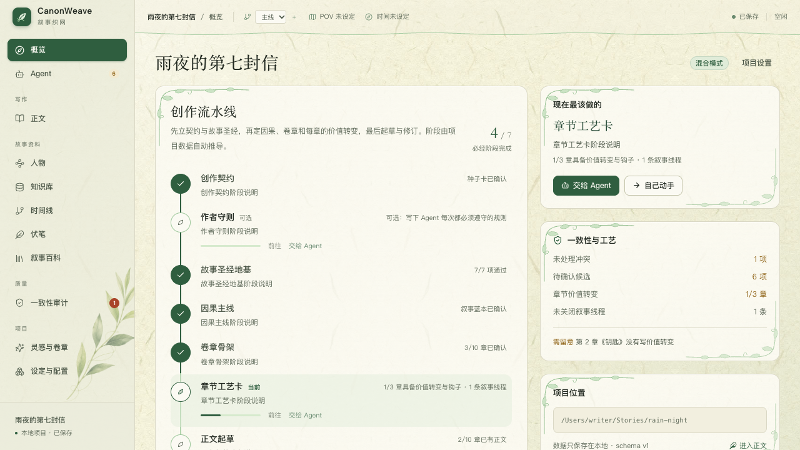
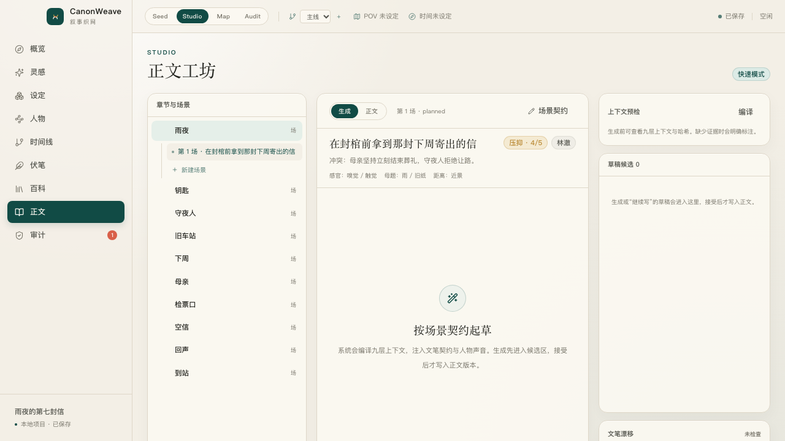
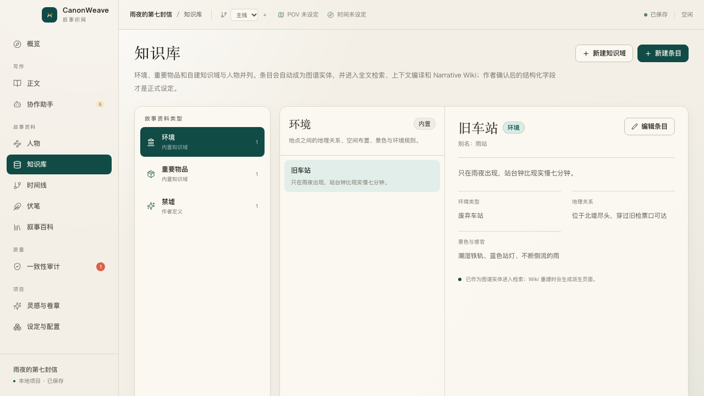
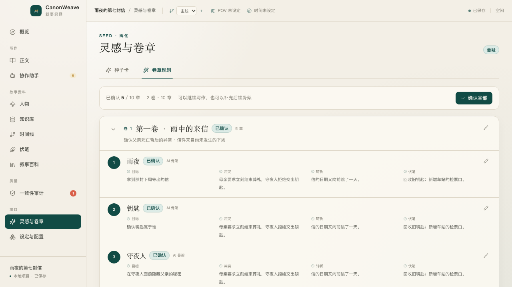
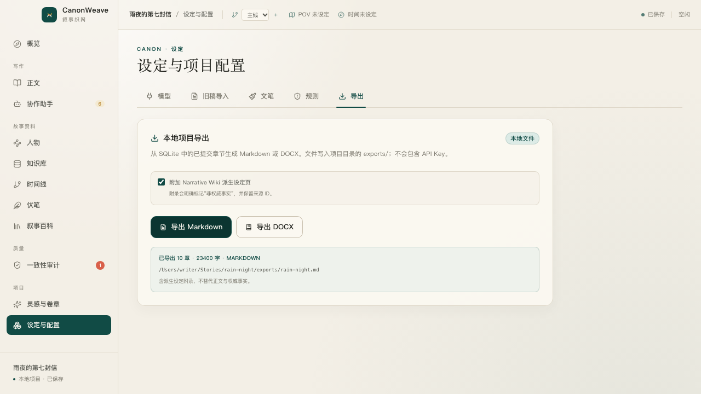

# CanonWeave · 叙事织网

> Keep every story whole.

CanonWeave 是一个本地优先的长篇叙事创作工具。它帮助作者管理人物、事实、时间线、关系和伏笔，并在 AI 生成前后检查设定冲突、人物声音与文笔漂移。

所有项目数据保存在本地 SQLite 中。模型输出、旧稿抽取和对话建议都先进入候选区，只有确认后才会成为正式事实。



## 功能

- **灵感与卷章**：从一句话生成三种走向；章节总数、卷数和每卷章节数均由作者定义。
- **旧稿导入**：导入 TXT、Markdown、DOCX，按章节切分并抽取待确认事实。
- **叙事正典**：维护人物、地点、世界规则、事实、关系、事件和双时间线。
- **知识域**：环境、重要物品与作者自建的禁墟、神道、灾厄等专题知识库，支持自定义字段。
- **章节写作**：默认按章写作；只有需要多地点、多视角或多时间点时才拆分场次。
- **协作助手**：独立任务工作台，可直接运行一致性巡检、重建叙事图与知识视图，并在会话中解释结果。
- **一致性审计**：SQL 规则与 Z3 硬约束检查，返回来源证据和 `unsat core`。
- **风险审核**：L0-L3 分级、审核策略、批量确认、抽样复核和整批撤销。
- **人物声音**：用作者样本建立人物声音质心，定位台词和 POV 漂移片段。
- **叙事文笔**：七种预设、六维调节、作者样本校准和 A/B 本地偏好。
- **图谱与百科**：双时间线、关系图、GraphRAG 社区摘要和可重建 Narrative Wiki。
- **伏笔管理**：记录埋设、推进和兑现契约，兑现必须有原文与状态变化证据。
- **版本与导出**：正文快照、版本回滚，以及 Markdown、DOCX 导出。

| 正文工坊 | 叙事图谱 |
| --- | --- |
|  |  |

| 知识库 | Multi-view 卷章 |
| --- | --- |
|  |  |

| Narrative Wiki | 项目导出 |
| --- | --- |
|  |  |

> 截图使用测试项目数据，仅用于展示界面。

## 开发文档

- [文档导航](docs/README.md)
- [当前工程交接](docs/handoffs/2026-10-21-current-state.md)
- [当前架构](docs/ARCHITECTURE.md)
- [数据模型](docs/DATA_MODEL.md)
- [开发规格](叙事织网_开发文档.md)
- [开发进度](开发进度.md)

## 快速启动

需要 Node.js 20.19+ 或 22.12+、Rust 1.77+，以及 Tauri 对应的系统依赖。

### macOS

双击：

```text
CanonWeave.command
```

或在终端运行：

```bash
./quick-start.sh
```

### Windows

双击：

```text
CanonWeave.cmd
```

或在 PowerShell 中运行：

```powershell
.\quick-start.ps1
```

启动工具会自动检查 Node/Rust、缺少依赖时执行 `npm install`，然后打开桌面应用。

其他启动方式：

```bash
npm start                   # 已安装依赖时直接启动
./quick-start.sh --web      # 浏览器界面预览
./quick-start.sh --build    # 构建发行版
./quick-start.sh --install  # 只检查环境并安装依赖
```

浏览器预览不包含 Tauri、SQLite 和系统钥匙串功能，正常使用请启动桌面应用。

## 第一次使用

1. 在“设定与配置 → 模型”中填写 OpenAI 兼容接口的 Base URL、API Key 和模型名。
2. 点击“测试连接”。API Key 会保存到系统钥匙串。
3. 选择一个空目录，创建新项目，或打开已有项目。
4. 选择“从一句话开始”“导入旧稿”或“两者都有”。

Base URL 可以填写 API 根地址，例如：

```text
https://api.openai.com/v1
```

## 基本流程

### 1. 建立故事骨架

进入“灵感与卷章”，输入一句话并生成三种走向。确认种子卡后，可以选择单卷直排并填写章节总数，也可以逐卷填写卷名和每卷章节数。大型结构会分批生成，避免一次输出被截断。

### 2. 导入或补全资料

在“设定与配置 → 旧稿导入”导入已有稿件，或通过人物、知识库、时间线和伏笔页面补全项目资料。

导入和抽取产生的内容都会先进入“审计”候选区。

### 3. 建立人物、知识域与文笔

人物页记录欲望、缺陷、秘密和声音样本；知识库内置“环境”和“重要物品”，也可以建立“禁墟”“神道”“灾厄”等自定义知识域。自建知识条目会自动成为图谱实体，并参与检索、上下文编译与 Wiki。

### 4. 按章生成正文

进入“正文”选择章节并建立本章写作任务，填写目标、冲突、POV、地点、情绪节拍与母题。普通单线章节不需要先设计场景；需要多地点、多视角或时间跳转时，再打开“分场编辑”。

可以先查看上下文预检，再选择：

- 快速：直接起草
- 精修：起草后润色，并检查硬事实变化

生成内容先进入草稿候选，接受后才写入正文版本。

### 5. 审核设定变化

在“审计”中处理人物、事实、关系和伏笔候选。

- L0/L1 可按策略批量处理
- L2 需要单条确认
- L3 硬冲突必须人工处理

### 6. 使用协作助手检查图谱、伏笔和百科

- “协作助手”可直接运行一致性巡检、重建叙事图和知识视图，也可以继续追问具体结果。
- “时间线”查看双时间线、关系图和全书分析。
- “伏笔”维护埋设、推进与兑现证据。
- “叙事百科”从已确认数据编译人物、地点、知识条目、规则、时间线、伏笔和章节摘要。

确认事实变化后，百科会自动标记过期，可一键全量重建。

### 7. 导出

进入“设定与配置 → 导出”，选择 Markdown 或 DOCX。文件会写入项目目录的 `exports/`，不会包含 API Key。

## 项目数据

创建项目后会得到：

```text
story-project/
  project.json
  narrative.sqlite
  imports/
  exports/
  backups/
```

`narrative.sqlite` 是唯一权威数据源。Wiki、社区报告和检索索引都是可重建的派生数据。

建议关闭项目后备份整个故事目录，而不是只复制数据库文件。

