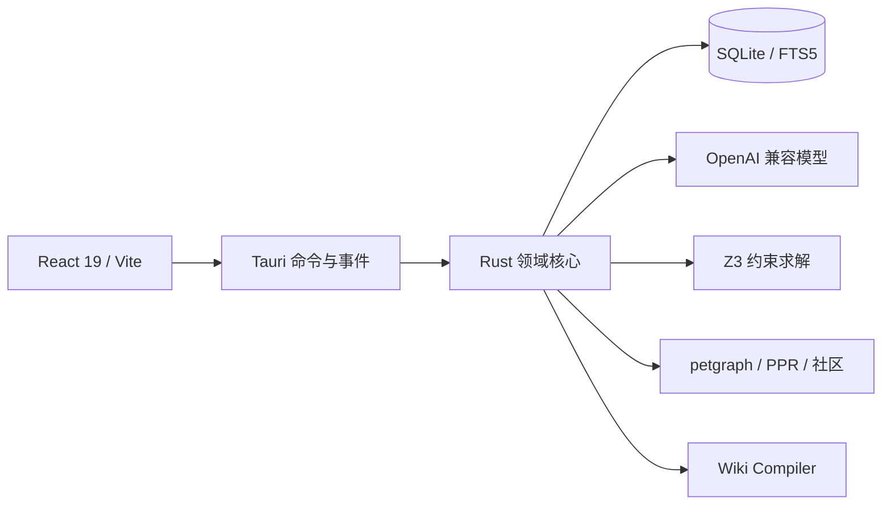

# CanonWeave 当前架构

## 总体结构



原则：

- Tauri 2 提供桌面壳、系统对话框、钥匙串和前后端 IPC。
- React 不直接访问 SQLite。
- Rust 命令是事务和领域写入口。
- SQLite 是唯一权威数据源。
- Wiki、社区摘要和检索索引均可重建。

## 前端信息架构

左侧导航分为：

| 分组 | 页面 |
| --- | --- |
| 概览 | 项目状态和下一步 |
| 写作 | 正文、协作助手 |
| 故事资料 | 人物、知识库、时间线、伏笔、叙事百科 |
| 质量 | 一致性审计 |
| 项目 | 灵感与卷章、设定与配置 |

主要页面：

- `features/studio`：按章写作；场景仅在需要时作为分场工具显示。
- `features/seed`：种子卡、叙事蓝本、图形化因果图、作者定义卷章、旧稿导入和骨架。
- `features/agent`：独立任务助手与协作会话。
- `features/knowledge`：环境、物品和自定义知识域。
- `features/characters`：人物核心和声音样本。
- `features/map`：双时间线、图谱和 GraphRAG 全书问答。
- `features/audit`：冲突队列、审核策略和批量处理。
- `features/wiki`：可重建 Narrative Wiki。

## Rust 模块

| 模块 | 职责 |
| --- | --- |
| `commands/` | Tauri IPC 边界；解析状态、调用领域函数、返回前端类型 |
| `project.rs` | 创建、打开、关闭项目，目录和 schema 版本 |
| `db/` | SQLite 连接、迁移和版本检查 |
| `seed.rs` / `outline.rs` | 种子卡、卷级与章节骨架 |
| `knowledge.rs` | 知识域、知识条目、FTS 同步和实体同步 |
| `scenes.rs` | 章节、场景、正文版本和索引 |
| `context.rs` | L0-L8 上下文编译器 |
| `retrieval.rs` | jieba 分词、FTS5、PPR |
| `graphrag.rs` | 图谱、社区 Detection、GraphRAG 上下文、影响集 |
| `rules.rs` / `solver.rs` | SQL 规则、Z3 硬约束和冲突证书 |
| `wiki.rs` | Narrative Wiki 全量编译和 Wiki 编辑候选 |
| `voice.rs` / `style.rs` | 人物声音和项目文笔指标 |
| `chat.rs` | 会话、消息、分叉和候选沉淀 |
| `llm.rs` | OpenAI 兼容请求、流式输出和结构化输出解析 |

## 主要数据流

### 叙事蓝本与卷章

```text
确认种子卡
  → 生成人物/势力/世界规则/时间线/叙事线地基
  → 生成唯一因果链与呈现契约
  → 完整性诊断（错误阻断确认）
  → 作者确认叙事蓝本
  → adaptive：估算体量和阶段；fixed：适配目标章节/任务数
  → 每 16 章一批把逻辑节点编排为章节骨架
  → 成功后一次性写 outline_node + logic_node_ids
  → 作者确认
  → 建立 chapter，并写 volume_id
```

### 知识条目

```text
作者填写知识域动态字段
  → knowledge_entry
  → 同步 entity
  → 重建该类条目的 FTS5 文档
  → 进入上下文编译、GraphRAG 和 Wiki
```

### 正文生成

```text
本章写作任务 + 逻辑节点 + 呈现契约
  → context::compile（L1 注入叙事蓝本与因果链）
  → 按 novel/game 选择散文或对白/环境/道具/过场脚本
  → generation
  → candidate
  → 审计 / 人工确认
  → revision + snapshot + FTS
```

## 一致性边界

- 世界事实、角色信念和不可靠叙述由 `truth_layer` 分开。
- 时间线、分支和来源片段属于事实记录。
- Z3 只用于可形式化硬约束。
- 动机、人物声音和文笔漂移只做软提示。
- 作者例外、修改正文、修改设定和建立分支都是正式解决动作。

## 现有扩展点

- 知识域字段 schema 可继续扩展日期、枚举、实体引用等字段类型。
- 当前知识条目只保证实体级图谱接入，跨知识条目的专用关系边仍待增加。
- GraphRAG 已有社区摘要和影响集；可替换为 Leiden 和分层社区。
- 协作助手当前是受限任务编排，可继续增加“计划 → 工具 → 证据 → 审批”的持久化运行记录。
