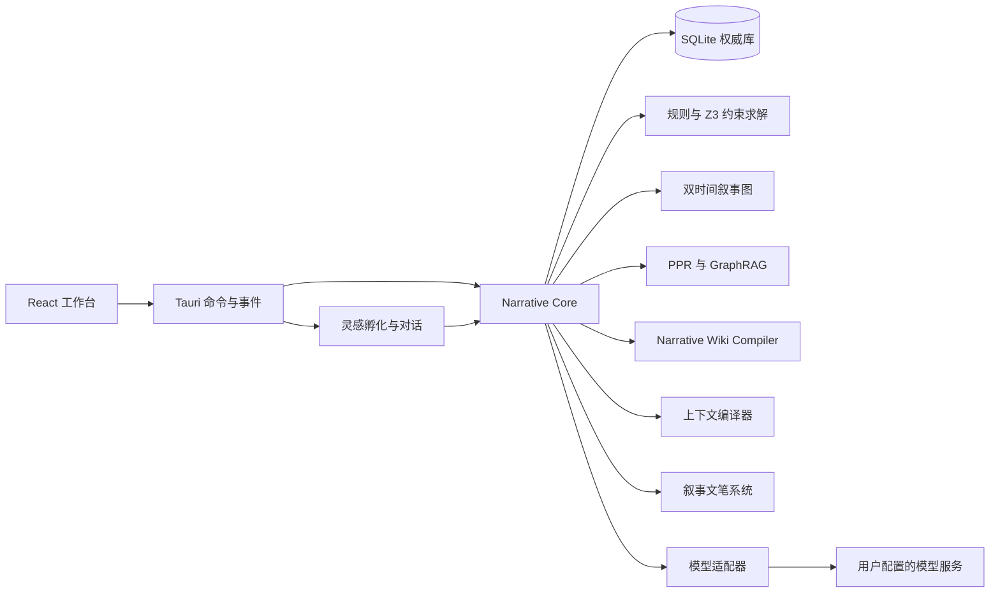
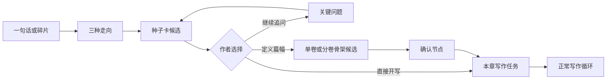

# CanonWeave（叙事织网）开发规格

> 版本：1.4  
> 日期：2026-10-21  
> 本版新增：作者定义卷章结构、环境/物品/自定义知识域、独立协作助手、可选分场写作和 schema v6 实现快照。  
> 用途：作为开发 AI 的唯一实现依据。实现时不要自行扩大范围或发明新架构。

## 0. 当前实现与文档入口

本文件描述目标架构和不可违反的产品约束；具体代码状态、文件入口和下一步工作见：

- [工程交接：2026-10-21](docs/handoffs/2026-10-21-current-state.md)
- [当前架构](docs/ARCHITECTURE.md)
- [数据模型](docs/DATA_MODEL.md)
- [开发进度](开发进度.md)

截至 2026-10-21，M0-M5 核心能力已实现，并在其上完成作者定义卷章、通用知识域、导航重排和协作助手。新会话应先读交接文档，再按本规格检查实现是否偏离契约。

## 1. 产品定义

**CanonWeave（中文名：叙事织网）**是一个本地优先的长篇叙事一致性创作工具，面向网络小说作者、连载作者和游戏剧情设计师。它支持从一句话灵感起步，也支持导入已有稿件，并允许作者为项目配置独立的叙事文笔。

英文名强调“维护故事正典，并把人物、时间、关系与伏笔编织成整体”。可用宣传语：

> CanonWeave - Keep every story whole.

产品解决的问题不是“让模型多写字”，而是：

1. 记录故事世界中的事实、状态、关系和时间。
2. 为生成任务编译一份有来源、有优先级、受预算控制的上下文。
3. 生成后检查事实冲突、视角泄露、人物漂移和伏笔遗漏。
4. 让每次修改都能定位证据、比较影响、回滚或建立分支。
5. 让作者用可配置的叙事文笔写作，并检查文笔是否偏离设定。
6. 让作者决定章节或卷章规模，并把环境、物品与作品专属知识作为可查询资料维护。

**产品承诺**：

> 降低长篇设定漂移和伏笔遗漏，让矛盾可定位、修改可审阅、版本可回滚，文笔可调、可查、可复现。

不承诺“零矛盾”，不替代作者的审美判断，不替作者决定风格，不自动发布作品。

### 1.1 本地使用方式

首次启动只要求用户完成三件事：

1. 填写 Base URL、API Key、模型名，并测试连接。
2. 选择一个本地项目目录。
3. 新建项目时选择“从一句话开始”“导入旧稿”或“两者都有”。

所有项目数据必须保存在用户选择的目录内：

```text
story-project/
  project.json
  narrative.sqlite
  imports/
  exports/
  backups/
```

- API Key 存入系统钥匙串，不写入项目目录、日志或导出文件。
- 默认只支持 OpenAI 兼容的 `/chat/completions`；嵌入模型可选。
- 关闭网络后，除模型调用外，界面、检索、编辑、版本和导出仍应可用。

## 2. 参考产品与差异化

参考仓库：

`https://github.com/EthanYoQ/AI-Novel-Writer`

可借鉴的是信息架构和交互原则：

- 项目首页清楚展示进度。
- 设定、架构、蓝图、正文形成连续写作流程。
- 正文居中，审阅和修改确认在侧页完成。
- AI 任务有独立运行面板，可暂停、取消和恢复。
- 每一步结果都落盘，定稿和版本可追溯。

不复制其代码、Logo、图标、文案、截图、配色和具体页面布局。该仓库使用 GPL-3.0；如需复用其中任何源码，必须重新评估整个项目的许可证义务。

### 2.1 必须做出差异化的技术支柱

1. **多视角真值模型**：区分世界事实、角色认知、角色陈述和不可靠叙述。
2. **可执行约束与时间求解**：普通规则走 SQL/图查询，复杂时间、地点和资源约束交给 SMT 求解器，并返回最小冲突核心。
3. **图谱检索与 GraphRAG**：逐章使用混合检索和图扩散，全书级理解使用社区摘要与 map-reduce 分析。
4. **Narrative Wiki Compiler**：把事实编译成带来源、可重建的叙事百科，但百科不是权威事实源。
5. **伏笔兑现契约**：伏笔不仅有状态，还规定“怎样才算真正兑现”。
6. **人物声音指纹与弧线罗盘**：同时监控人物是否崩坏、是否只是稳定但扁平。
7. **分支感知的叙事事件溯源**：时间线分支、事实有效期和版本快照统一管理。
8. **零文档灵感孵化**：一句话经过种子卡和骨架变成可写作结构，对话内容可沉淀为候选事实。
9. **叙事文笔系统**：项目级文笔档案、样本锚点、双通道生成和文笔漂移检查，与人物声音分开建模。
10. **可扩展知识域**：环境、重要物品和禁墟、神道、灾厄等自定义知识域共享实体、检索、GraphRAG 和 Wiki 链路。
11. **独立任务助手**：会话拥有自己的入口，可调用巡检、图谱和 Wiki 等现有工具，但写入仍受候选与审批边界约束。

技术定位：

> CanonWeave 是一个基于双时间叙事图谱、可执行约束求解、来源证据链和可配置叙事文笔的本地创作工作台。

## 3. 技术栈

| 层 | 技术 |
| --- | --- |
| 桌面壳 | Tauri 2 |
| 前端 | React 19、TypeScript、Vite、Tailwind CSS、Radix UI、Zustand |
| 编辑器 | CodeMirror 6 |
| 图谱 | Cytoscape.js |
| 图计算 | petgraph + 加权标签传播；社区检测接口可替换为 Leiden |
| 时间线 | 自研双时间泳道或 vis-timeline |
| 本地核心 | Rust、rusqlite、SQLite FTS5 |
| 中文检索 | jieba-rs 分词 + FTS5 trigram 回退 |
| 逐章检索 | BM25/FTS5 + 可选 sqlite-vec + 图谱 Personalized PageRank |
| 全书分析 | GraphRAG 风格的社区发现、社区摘要和 map-reduce 问答 |
| 硬约束求解 | Z3（Rust binding）；返回 unsat core 作为冲突证据核心 |
| 叙事百科 | Narrative Wiki Compiler；页面为可重建派生视图 |
| 灵感孵化 | 种子卡、对话会话、章节骨架；对话与候选事实分离 |
| 文笔分析 | 本地句法、词汇、意象统计 + 可选嵌入距离；模型评分只做解释 |
| 文笔生成 | 文笔契约注入；快速单通道与精修双通道 |
| 模型协议 | OpenAI 兼容 Chat Completions，支持流式输出与取消 |
| 密钥 | keyring；禁止明文写入项目 |
| IPC 类型 | tauri-specta 生成 TypeScript 类型 |
| 测试 | Rust 单元/属性测试、Vitest、Playwright |

不引入独立图数据库。关系图保存在邻接表中，用递归 CTE 完成 2 至 3 跳查询。

### 3.1 架构



原则：

- SQLite 是唯一权威数据源。
- React 只保存界面状态，不复制领域事实。
- 所有生成结果先创建候选记录；正式写入必须经过作者确认，或由作者预先授权的审核策略批量确认。
- Wiki 页面、GraphRAG 社区摘要和向量索引都是派生数据，可删除并重建。
- 每次生成记录提示词版本、上下文包哈希、模型和参数。
- 对话、种子卡和骨架同样只能进入候选区，不能直接成为权威事实。
- 文笔润色不得改变硬事实，精修模式必须执行事实差异检查。

### 3.2 目录约定

```text
src/
  app/
  components/
  features/project/
  features/seed/
  features/canon/
  features/characters/
  features/timeline/
  features/promises/
  features/voice/
  features/wiki/
  features/insights/
  features/studio/
  features/audit/
  features/settings/
  lib/ipc.ts
  stores/ui.ts

src-tauri/
  src/commands/
  src/domain/
  src/db/
  src/llm/
  src/graph/
  src/retrieval/
  src/seed/
  src/voice/
  src/consistency/
  src/solver/
  src/wiki/
  src/graphrag/
  src/export/
  migrations/
```

### 3.3 IPC 契约

React 不得直接访问 SQLite。所有读写通过 Tauri 命令完成：

```text
project_create / project_open / project_close
model_save / model_test
document_import
seed_create / seed_answer / seed_commit
chat_session_create / chat_session_update / chat_session_archive / chat_session_fork
chat_start / chat_send / chat_cancel / chat_capture / chat_continue / chat_to_scene
outline_generate / outline_commit
style_profile_save / style_sample_add / style_analyze / style_compare
style_check
extraction_run
context_preview
generation_start / generation_cancel
audit_run
review_queue / review_batch_preview / review_batch_apply / review_undo
review_policy_save
insight_query
wiki_rebuild
revision_commit
export_project
```

流式生成使用事件：

```text
generation://delta
generation://progress
generation://finished
generation://error
chat://delta
chat://finished
chat://error
```

命令参数和返回值由 Rust 类型导出为 TypeScript，禁止前后端各写一份结构体。

## 4. 四层约束

| 层 | 内容 | 处理方式 |
| --- | --- | --- |
| 硬约束 | 世界规则、锁定事实、死亡、不可逆事件、时间线、持有物、地点、物理规则 | 确定性检查；严重冲突阻止提交 |
| 软约束 | 动机、认知边界、关系变化、人物语气、叙事节奏、伏笔质量 | 语义检查；提示并附证据，由作者决定 |
| 表达约束 | 叙事视角、句法节奏、意象密度、情绪表达、描写配比、禁例 | 文笔检查；给片段级建议，由作者决定 |
| 创作约束 | 主题、潜台词、反转、开放性、故意不可靠叙述 | 只提供建议，不自动阻断 |

任何软约束、表达约束和创作约束都必须支持：

- 本次例外
- 永久例外
- 修改正文
- 修改设定
- 建立新分支

例外必须记录原因和规则指纹，措辞变化后仍能匹配。

表达约束不阻断提交，但会进入 `style_drift` 和画面感检查。它只提示“偏离了哪一维、偏离了多少、原文在哪里”，不自动改写正文。

### 4.1 多视角真值

同一个命题在不同叙事层可以同时为真：

- `world`：故事世界中客观成立。
- `belief`：某个角色相信，但未必为真。
- `utterance`：角色说过，可能是在撒谎或误传。
- `narrative`：叙述者给出的信息，可能不可靠。
- `planned`：作者计划稍后揭示的真相。

例如：

```text
world:       父亲已死亡
belief:      林澈相信父亲已死亡
utterance:   村长声称父亲已经死亡
planned:     第 18 章揭示父亲仍活着
```

这四条不应被判为互相冲突。只有同一实体、同一谓词、同一时间范围、同一真值层且适用范围重叠的矛盾，才进入硬冲突检查。

## 5. 核心数据模型

所有权威事实都必须包含 `source_span`、`status`、`version` 和确认状态。

| 表 | 关键字段 |
| --- | --- |
| `project` | id、name、root_path、schema_version、writing_language |
| `premise` | id、logline、genre、subgenre、theme、emotional_promise、tone、core_conflict、world_hook、pov、person、tense、target_length、update_rhythm、ending_intent、taboo、status、source_message_id、field_sources、version |
| `chat_session` | id、project_id、scope、scene_id、branch_id、parent_session_id、mode、title、model、status、summary、summary_hash、last_message_at、created_at |
| `chat_message` | id、session_id、role、content、model、tokens、created_at、linked_candidate_ids、pinned |
| `candidate` | id、project_id、kind、payload、source_span、source_message_id、confidence、risk_level、status、batch_id、created_at |
| `outline_node` | id、project_id、parent_id、level、order_no、title、goal、conflict、turn、payoff、status、branch_id、source |
| `story_structure` | project_id、mode、total_chapters、spec、updated_at |
| `source_document` | path、hash、type、imported_at |
| `chapter` | number、volume_id、title、status、current_revision_id、style_profile_id、style_epoch |
| `scene` | chapter_id、goal、conflict、pov、story_time、branch_id、place_id、style_profile_id、emotion_beat、sensory_plan |
| `entity` | id、type、canonical_name、aliases、status |
| `character_core` | entity_id、desire、need、fear、flaw、values、secret、taboo |
| `knowledge_domain` | id、project_id、key、name、description、icon、is_system、sort_order、field_schema |
| `knowledge_entry` | id、domain_id、entity_id、name、aliases、summary、fields、status |
| `claim` | subject、predicate、object、truth_layer、perspective_id、valid_from、valid_to、branch_id、source_span、confidence、status |
| `event` | participants、place、story_time、reveal_time、cause、outcome、branch_id、source_span |
| `relation` | from、to、type、direction、valid_from、valid_to、evidence_id |
| `promise` | title、state、plant_scene、target_window、payoff_contract、evidence_ids |
| `arc_beat` | character_id、chapter_id、before、event、after、evidence_id |
| `style_profile` | id、project_id、scope、scope_id、name、pov、person、tense、syntax、lexicon、imagery、rhetoric、emotion、ratios、anti_style、version、status |
| `style_sample` | id、profile_id、text、source_span、source_type、approved、tags、embedding_id |
| `motif` | id、project_id、name、meaning、channels、first_scene_id、last_scene_id、use_count、status |
| `preference` | id、project_id、scene_id、left_run_id、right_run_id、chosen_run_id、reason、dimension_scores、created_at |
| `rule` | code、constraint_layer、severity、predicate、exception_scope |
| `issue` | rule_id、severity、claim_ids、evidence_spans、explanation、certificate、solver_core、metric_snapshot、risk_level、batch_id、deferred_until、status |
| `review_policy` | id、project_id、scope、scope_id、mode、auto_accept_level、sample_rate、lock_hard、updated_at |
| `review_batch` | id、project_id、chapter_id、policy_id、item_count、accepted_count、rejected_count、revision_id、created_at |
| `revision` | parent_id、diff、snapshot_id、author_action、created_at |
| `generation_run` | model、params、context_hash、prompt_version、style_profile_version、generation_mode、review_mode、fact_delta、status、error |
| `graph_community` | level、member_ids、summary_hash、generated_at、stale_at |
| `wiki_page` | entity_id、kind、content_hash、source_ids、generated_at、stale_at |

## 6. 十个核心引擎

### 6.1 约束编译器

作者规则不能只存成自然语言提示词。规则应编译为可执行谓词。

示例 DSL：

```yaml
rules:
  - id: dead_character_acts
    layer: hard
    severity: block
    when:
      - actor.status == "dead"
      - action.story_time > actor.death_time
    unless:
      - scene.mode in ["flashback", "memory", "ghost"]
```

MVP 至少实现以下确定性检查：

- 死亡后行动。
- 同一角色在同一时刻出现在两个地点。
- 事件因果顺序倒置。
- 角色在合理时间内无法完成移动。
- 物品已被销毁或交出却仍被持有。
- 关系方向或亲属关系冲突。
- 角色使用未获得、未目睹且未被告知的信息。
- 世界规则要求的代价或条件未满足。
- 伏笔超过计划窗口仍未推进。

检查分两条路径：

- 快速路径：简单事实键、区间重叠、关系方向和唯一性用 SQL/递归 CTE 处理。
- 求解路径：涉及多个时间区间、移动成本、唯一物品和排他条件时，将约束转成 Z3 表达式。

Z3 返回不可满足时，系统保存 `unsat core`，再把核心约束映射回事实、规则和原文证据。不要让所有规则都经过求解器；只有复杂硬冲突才使用。

检查结果必须包含 `certificate`：

```json
{
  "rule_id": "dead_character_acts",
  "severity": "block",
  "claim_ids": ["c101", "c208"],
  "evidence_spans": ["ch03:p42-44", "ch09:p18-20"],
  "solver_core": ["dead_at_ch03", "acts_at_ch09", "is_real_action"],
  "explanation": "角色在第 3 章死亡，但第 9 章以现实行动出现。",
  "suggested_actions": ["修改正文", "标记为回忆", "建立分支"]
}
```

证书表示“系统为什么认为这里有问题”，不是全局一致性的数学证明。

### 6.2 图谱检索、PPR 与 GraphRAG

逐章写作和全书分析使用两套不同的检索策略。

**逐章检索**：

1. 以当前 POV、出场人物、地点、场景目标和到期伏笔作为种子节点。
2. 先按时间线、分支和 POV 过滤不可见事实。
3. 在叙事图上运行 Personalized PageRank，召回多跳相关节点。
4. 与全文检索、可选向量检索合并并重排。

```text
score =
  0.30 × BM25
+ 0.25 × 向量相似度（可用时）
+ 0.30 × 图谱 PageRank
+ 0.15 × 时间接近度
```

权重可配置；时间、分支和 POV 过滤是不可跳过的硬过滤。

**GraphRAG 全书分析**：

- 对叙事图执行社区发现。
- 为每个社区生成带来源的社区报告。
- 对“主线如何发展”“哪些关系推动当前局面”“哪些伏笔仍形成叙事债务”等全书问题执行 map-reduce 分析。
- 社区报告按图谱内容哈希缓存，事实或关系变化后标记过期。

GraphRAG 只负责全局理解、关系发现和线索归纳，不作为事实真值，也不直接决定硬冲突。所有社区报告必须保存 `source_ids`，可回到原文。

### 6.3 Narrative Wiki Compiler

本规格把 LLM-Wiki 落地为 Narrative Wiki Compiler。它是由已确认事实编译出的可读派生视图，用来做人类浏览、GraphRAG 缓存和检索导航。

首批页面：

- 人物档案：核心欲望、恐惧、关系、成长轨迹、代表台词。
- 地点档案：地理关系、事件、控制势力和相关人物。
- 世界规则：条款、代价、例外和违规案例。
- 时间线：故事时间、叙述时间、分支和有效区间。
- 伏笔：埋设、推进、预期兑现和当前风险。
- 章节摘要：事件、状态变化和未解决问题。

每个页面必须包含：

- `source_ids` 和可点击的来源片段。
- 内容哈希与生成版本。
- 过期状态。
- 全量重建入口。

Wiki 文本不能反向覆盖 SQLite 中的作者确认事实。作者编辑 Wiki 时，必须走“提出事实变更 → 差异确认 → 提交”流程。未经确认的 Wiki 内容只能作为检索辅助，不能作为硬事实依据。

### 6.4 伏笔兑现引擎

伏笔状态：

`planned → planted → reinforced → ready → paid_off | abandoned`

`payoff_contract` 必须说明兑现条件，例如：

- 揭示哪条信息。
- 改变哪个角色的认知。
- 交付哪件物品。
- 触发哪个事件。
- 回收哪段情绪或关系。

伏笔标记为已兑现时，必须同时存在：

1. 原埋设证据。
2. 新兑现证据。
3. 可定位的读者认知或故事状态变化。

只出现关键词不算兑现。

### 6.5 人物声音指纹与弧线罗盘

本节只处理人物对话中的“谁在说话”。整本书的叙事文笔、镜头距离和描写节奏见 6.9；两者共用样本分析工具，但不能互相替代。

人物不只保存属性，还要保存：

- 欲望、需求、恐惧、缺陷、秘密和底线。
- 当前关系立场。
- 本章所处的成长节点。
- 作者认可的语气样本。
- 对话长度、常用词、停顿方式和称谓习惯。

生成前向模型提供：

- 当前 `arc_beat`
- 一段作者认可的 `voice_anchor`
- 当前欲望、恐惧和关系张力

生成后输出两类软检查：

- `character_invariant`：是否违反人物底线、能力或关系约束。
- `voice_drift`：与作者样本的语义和文体距离是否异常。

`voice_drift` 使用本地可解释评分，不直接让模型打一个模糊总分：

- 只抽取该人物的对话和由他视角展开的段落，整本书的叙述文笔交给 6.9 检查。
- 计算句长均值、句长方差、标点频率、代词偏好、对话/动作比例。
- 如配置嵌入模型，再加入语义向量距离。
- 与作者批准的该人物声音质心比较，记录片段级分数。

权重和阈值可按人物调整，结果只作为软提示。

声音漂移只提示，不自动改写。人物成长必须允许变化，但变化需要事件证据。

### 6.6 上下文编译器

上下文按固定分层生成，并记录哈希：

```text
[L0 HARD CANON]
[L1 ACTIVE STATE]
[L2 POV KNOWLEDGE]
[L3 WIKI INDEX]
[L4 DUE PROMISES]
[L5 EVIDENCE EXCERPTS]
[L6 VOICE & STYLE]
[L7 TASK CONTRACT]
[L8 FINAL HARD CONSTRAINTS]
```

默认预算可配置：

| 分区 | 建议占比 |
| --- | ---: |
| 硬规则 | 12% |
| 当前状态 | 17% |
| Wiki 索引 | 4% |
| 伏笔与承诺 | 9% |
| 原文证据 | 33% |
| 人物声音样本 | 6% |
| 叙事文笔契约 | 8% |
| 任务要求 | 11% |

`L6` 内部分两部分：人物声音锚点回答“这句话像谁说的”，叙事文笔契约回答“这个镜头怎么写”。文笔契约低于硬事实，任何风格偏好都不能覆盖 `L0` 和 `L8`。

原文证据优先，不使用二手摘要替代可回查文本。检索组合：

- 实体名与别名精确匹配。
- FTS5 中文分词全文检索。
- 可选向量召回。
- 图关系 2 至 3 跳扩展。
- 叙事图 Personalized PageRank。
- 时间、分支和 POV 过滤。

`WIKI INDEX` 只提供导航和压缩提示，不能替代 `EVIDENCE EXCERPTS`。GraphRAG 社区摘要不进入逐章正文上下文，只有其索引可直接回到来源时才可作为补充。

### 6.7 生成事务


快速模式跳过文笔润色与事实差异检查，直接进入事实抽取；精修模式必须保留润色前后两版文本，并生成 `fact_delta`。

每章生成必须返回：

- 正文
- 文笔润色版本与 `fact_delta`（精修模式）
- 新事实候选
- 状态变化
- 关系变化
- 伏笔操作
- 引用来源

引用只写入结构化元数据，不插入正文，避免破坏文学文本。

任一步失败不得提交半个版本。用户取消生成时，已收到的文本只能进入“恢复候选”。

### 6.8 灵感孵化、协作会话与骨架

零文档起步也需要一个孵化期：先把一句话变成作者确认过的种子和骨架，再由系统按章持续生成。直接让模型一次写一百章，结构容易空泛，也不利于后续校验和修改。



#### 6.8.1 三种入口

| 入口 | 适用情况 | 系统行为 |
| --- | --- | --- |
| 一句话 | 只有 logline、一个画面或一句冲突 | 生成 3 种走向，最多追问 5 个关键问题，产出种子卡 |
| 对话 | 作者想边聊边想 | 多轮共创，消息可随时“采纳为”候选 |
| 旧稿 | 已有正文或设定 | 走导入与抽取流程，种子卡从旧稿归纳 |

三个入口可以混用。作者可以先聊再导入，也可以先导入再补种子卡。

#### 6.8.2 种子卡

`premise` 是项目的创作契约，不是世界事实。字段如下：

| 字段 | 说明 |
| --- | --- |
| `logline` | 一句话故事 |
| `genre` / `subgenre` | 类型与子类型 |
| `theme` | 故事想讨论的核心命题 |
| `emotional_promise` | 读者应获得的情绪体验 |
| `core_conflict` | 谁想要什么，什么在阻止 |
| `protagonist_desire` / `flaw` / `secret` | 主角驱动、缺陷与秘密 |
| `world_hook` | 1 至 3 条世界规则钩子 |
| `tone` | 情绪基调与目标读者 |
| `pov` / `person` / `tense` | 叙事视角约定 |
| `target_length` / `update_rhythm` | 目标篇幅与更新节奏 |
| `ending_intent` | HE、BE、开放或未定 |
| `taboo` | 不写什么、不能出现什么 |
| `status` | candidate / confirmed / archived |
| `source_message_id` | 来自哪条对话，或标记为 author |

种子卡的最小必填字段是 `logline`、`core_conflict` 和 `status`，其余字段允许后补。系统不要求作者一次填完所有设定。

AI 补全的字段在 `field_sources` 里标记为 inferred，作者可以逐项改成 author。确认种子卡时，界面要显示哪些字段来自 AI 推断，避免作者把默认值当成自己的决定。

种子卡确认后进入 `L1` 当前状态和 `L7` 任务契约，不进入硬事实层。作者改种子卡不等于改已确认事实，涉及世界规则的修改仍要走事实变更流程。

三种走向分别保存为 `premise` 候选。作者选中一条后，其余标记为 archived，不删除，便于回看当时的取舍。

#### 6.8.3 对话沉淀

- 每次对话属于一个 `chat_session`，消息写入 `chat_message`。
- 作者可以选中任意段落，选择“采纳为”：设定、人物、规则、伏笔、章节目标或文笔样本。
- 采纳动作创建候选，保留 `source_message_id` 和原文引用；作者确认后才写入正式表。
- 对话摘要单独保存，只用于压缩上下文，不能当作事实。
- 删除对话不删除已确认事实；已确认事实也不随对话回滚。
- 对话与会话摘要不进入 GraphRAG 社区发现和 Wiki 编译，只有确认后的事实才会进入派生视图。

对话模式：

| 模式 | 目的 | 上下文 |
| --- | --- | --- |
| 发散 | 找方向、找冲突、找人物 | 种子卡 + 最近对话 + 少量母题，不检索全书 |
| 结构 | 推演卷、章、场景 | 种子卡 + 骨架 + 已确认主线事实 |
| 查设定 | 回答“这个人现在知道什么” | 走正常检索与视角过滤，答案附来源 |

对话窗口必须区分“建议”和“已确认”。AI 在对话里编出的设定，未经采纳不得在正文生成时被当作事实。

#### 6.8.4 故事骨架

`outline_node` 支持 act、volume、chapter、scene 四级。当前实现生成到卷、章两级：

- 作者可选择单卷直排，填写 1 至 1200 章。
- 作者也可逐卷填写卷名和章节数；最多 40 卷，全书最多 1200 章。
- 章节骨架每批生成 16 章，并注入全书结构、当前卷目标、上一批最近章节和作者知识库快照。
- 模型批次失败时不写入半成品；生成完成后一次性保存候选骨架。

每个卷或章节节点记录：

- 目标：这一章要改变什么。
- 冲突：谁阻止，代价是什么。
- 转折：读者预期如何被打破。
- 兑现：回收哪条伏笔，或新增哪条。
- 状态：candidate / confirmed / dropped。

作者可以只确认需要立即写作的章节。卷级确认会连同下属章节一起确认；骨架是路线图，不要求一次填满。

#### 6.8.5 失败与边界

- 一句话过于抽象时，给 3 个具体走向，不逼作者先回答“你的主题是什么”。
- 作者可以跳过追问，选择“按推荐方向继续”；系统用默认值补全种子卡并标记为 inferred，之后可逐项修改。
- 对话超过 12 轮仍未收敛时，提示“先写第一场”或“先生成骨架”，避免无限讨论。
- 对话内容与已确认事实冲突时立即标记，不静默覆盖。
- 对话默认只带种子、当前场景和检索片段，不把全书塞进上下文。

#### 6.8.6 会话管理与持续推进

会话不是一次性弹窗，而是独立的一级“协作助手”工作区；它可以与项目、场景和分支绑定。

- 每个会话有 `scope`：seed（孵化）、plot（推进剧情）、scene（当前场景）、lookup（查设定）、audit（解释冲突）。
- 新建会话支持三种方式：空白会话、从当前会话分叉、从摘要开始。
- 会话可以重命名、置顶、归档和删除；删除不影响已确认事实。
- 会话记录 `scene_id`、`branch_id` 和 `parent_session_id`。切换章节时默认新建 scene 会话，避免上下文串线。
- 每个会话保留最近 8 至 12 轮原文和一份滚动摘要，更长历史折叠，不无限增长。
- “推进剧情”模式：作者用自然语言说下一场要发生什么，AI 先给 3 个节拍选项，不直接写整章。选中后生成场景契约，再进入正文生成。
- “继续写”动作：从当前会话最后一条消息生成 500 至 800 字草稿，进入候选区。
- “记住这个决定”：把一条消息固定为会话约束，生成时进入 `L7` 任务契约；它仍然不是世界事实。
- 协作助手可直接调用一致性巡检、叙事图重建和 Narrative Wiki 重建。
- 会话系统消息注入待处理冲突、候选数量、未结伏笔和作者确认知识库快照；这些信息只帮助定位任务，不替代原文与权威事实。

会话列表默认按最近使用排序，并显示所属章节、模式和未采纳候选数量。作者可以随时新建会话，不必离开当前章节。

### 6.9 叙事文笔系统（Narrative Voice）

人物声音回答“这句话像谁说的”，叙事文笔回答“这个镜头怎么写”。两者必须分开建模，否则会把“人物说话像本人”误当成“整本书有文笔”。

#### 6.9.1 文笔档案

`style_profile` 可挂在项目、章节、视角人物、场景类型或具体场景上，优先级为具体场景、场景类型、章节、人物、项目依次递减。

| 维度 | 记录内容 | 例子 |
| --- | --- | --- |
| 视角与距离 | 人称、时态、心理距离、叙述可靠性 | 第三人称限知，距离 2/5 |
| 句法与节奏 | 平均句长、句长方差、段落长度、短句比例 | 18 至 26 字，长短交替 |
| 词汇与语域 | 具体与抽象比例、语域、动词强度、副词密度 | 具体名词优先，少用“仿佛” |
| 意象与感官 | 感官通道权重、母题库、颜色与天气 | 雨、铁锈、旧灯 |
| 修辞 | 比喻密度、反讽、重复、留白 | 每千字 2 至 3 个比喻 |
| 情绪表达 | 内心戏比例、外显程度、强度区间 | 克制外显，用动作写情绪 |
| 描写配比 | 动作、对话、描写、内心的比例 | 40 / 25 / 25 / 10 |
| 禁例 | 陈词、AI 腔、解释动机、四字堆砌 | 禁止总结式抒情 |

档案必须能导出为一段结构化“文笔契约”，不能只存几个形容词。

#### 6.9.2 三种建立方式

1. 预设：冷峻克制、热血爽文、古典雅致、悬疑冷感、温柔治愈、黑色幽默、电影感硬派。预设只是起点，作者可改。
2. 滑杆：句子长度、描写密度、情绪外显、意象密度、对话占比、叙述距离六个快捷维度，其余维度在高级编辑中调整。
3. 样本校准：作者贴入 3 至 8 段自己认可的文字，系统做本地统计并让模型总结特征，作者确认后生成档案。样本存入 `style_sample`，带来源和授权标记。

样本来源只允许作者原创、已授权文本或公版文本。产品不提供“模仿某位在世作家”的选项，只提供特征级描述和作者自己的样本。

#### 6.9.3 文笔契约示例

```text
[STYLE CONTRACT v3]
视角：第三人称限知，心理距离 2/5
句法：平均 18 至 26 字，长短交替，段落 3 至 5 句
词汇：具体名词优先，少用副词，每千字“仿佛/似乎”不超过 3 次
意象：雨、铁锈、旧灯；每场聚焦 1 至 2 个
情绪：用动作、感官和停顿呈现，不直接总结
配比：动作 40 / 对话 25 / 描写 25 / 内心 10
禁例：总结式抒情、解释动机、网络热词、四字排比
样本：<3 段作者认可原文>
```

文笔契约进入 `L6`，与人物声音样本并列。它低于硬事实：文笔偏好与已确认事实冲突时，事实优先。

#### 6.9.4 两种生成模式

| 模式 | 流程 | 适用 |
| --- | --- | --- |
| 快速 | 起草时直接注入文笔契约 | 日更、试写、低成本 |
| 精修 | 先起草，再按文笔契约润色，最后做事实差异检查 | 定稿、重要章节 |

精修模式必须做 `fact_delta`：对比润色前后的新事实、数字、人名、地点、死亡状态、持有物和时间。文笔润色不得改变硬事实；发现变化时阻止合并，交作者确认。

润色后字数增幅超过 25% 时提示“可能注水”，由作者决定是否保留。

#### 6.9.5 情绪节拍与画面感

场景契约增加两个字段：

- `emotion_beat`：目标情绪、强度 1 至 5、入场状态、出场状态、转折点。
- `sensory_plan`：本场使用 2 至 3 个感官通道、1 至 2 个母题、镜头距离。

`motif` 记录反复出现的意象及其含义、首次出现和最近使用。母题用得太密会失效，系统在密度过高时提示。

画面感检查看四件事：

- 是否有具体名词和可感知动作，而不是抽象情绪词。
- 是否调动了至少两个感官通道。
- 空间关系是否清楚：人在哪、朝向谁、周围有什么。
- 情绪是否有身体反应、动作或环境承接。

“他很愤怒”这类句子，如果没有动作或感官支撑，标记为 `tell_without_show`，给改写建议，不自动替换。

#### 6.9.6 文笔检查与漂移

本地指标：

- 句长均值、P90、方差。
- 对话占比、描写占比、内心戏占比。
- 每千字感官词密度、具体名词比例。
- 副词密度、比喻密度、陈词与 AI 高频套话命中数（如“空气仿佛凝固”“心中一震”，词表可配置）。
- 段落长度分布、重复句式开头。

可选语义指标：与作者样本质心的嵌入距离。

首版指标按中文写作校准；接入其他语言时，需要替换分词、句长和标点统计规则。

模型评分只做解释层，用 1 至 5 分评价画面感、情绪张力、视角一致性、用词准确和套路化程度，并引用原文片段。评分不能单独决定阻断。

`style_drift` 输出到审计页，包含偏离维度、当前值、目标区间、原文片段和修改建议。它只提示，不自动改写。

长篇允许文笔成长。`style_epoch` 标记卷或阶段的文笔版本，漂移检查对比当前 epoch，而不是全书开头。这样从轻快转向沉郁可以是计划内的变化。

#### 6.9.7 风格对比

同一场景可以用两套 `style_profile` 生成 A/B 版本，作者并排比较并选择。选择结果写入 `preference`，只用于本地调整权重，首版不做模型微调。

这个功能解决两个问题：作者说不清自己想要什么时，可以用比较代替描述；不同卷、不同视角需要不同文笔时，可以快速试验。

### 6.10 审核加速与批量确认

作者审核是质量闸门，但不必让每条候选都变成一次点击。系统按证据强度、冲突情况和影响范围给候选分级，模型置信度只作参考。

#### 6.10.1 风险分级

| 级别 | 判定条件 | 默认处理 |
| --- | --- | --- |
| L0 自动通过 | 原文精确引用、实体已存在、无冲突、未改锁定事实、影响范围可忽略 | 先建候选记录，按策略在同一事务中自动确认并写入权威库，可撤销 |
| L1 批量确认 | 有原文引用、无冲突、影响范围小 | 批量预览后一次接受 |
| L2 单条确认 | 涉及关系、死亡、时间、持有物、伏笔，或置信度低 | 逐条确认 |
| L3 必须处理 | 硬冲突、分支合并、不可逆事件 | 阻断提交，必须人工处理 |

模型置信度不能单独决定自动通过。至少要同时满足：有 `source_span` 或确认来源、无硬冲突、未改锁定事实、影响范围可计算。

自动通过仍然先创建 `candidate` 记录。策略只决定是否在同一事务里自动确认，它不是模型直接写库，而是作者预先授权的批量确认。

#### 6.10.2 审核策略

| 模式 | 自动通过 | 批量确认 | 适用 |
| --- | --- | --- | --- |
| 严格 | 无 | 无 | 定稿、关键章节 |
| 平衡（默认） | L0 | L1 | 日常写作 |
| 快速 | L0 | L0 + L1，抽样 10% | 日更、赶稿 |
| 草稿 | 不写权威库 | 只报硬冲突 | 试写、脑暴 |

策略可挂在项目或章节上。切换策略本身要记录，方便回看某一章为什么自动通过了较多内容。

#### 6.10.3 批量操作

- 接受本批低风险：显示数量、类型和影响范围，一次写入。
- 接受本章全部无冲突变更：只处理 L0/L1，L2/L3 留在队列。
- 全部拒绝 AI 推断字段：批量清理没有原文依据的补全。
- 应用到同类：同一实体的别名变体、同一规则的重复冲突一次处理。
- 稍后处理：进入队列，不阻断当前写作。
- 撤销整批：回到批次前的快照。

每次批量接受生成一个 `revision`，`author_action` 记为 `batch_accept`，并关联 `review_batch`。撤销按 revision 回滚，不逐条反向操作。

#### 6.10.4 审核队列

审计页默认按“必须处理、建议确认、已自动通过、稍后处理”分组。队列支持：

- 按风险、章节、实体、规则和影响范围筛选。
- 默认只显示新增和变化的条目，已处理项折叠；可切换“只看影响当前章/当前分支”。
- 同类问题合并，显示“共 N 处”，展开后逐条定位。
- 键盘操作：J/K 移动，A 接受，R 拒绝，E 编辑，U 撤销。
- 每条显示证据、影响范围和可执行处理选项。
- 批量接受前显示差异预览和预计影响章节。

#### 6.10.5 安全边界

- L3 永不自动通过，任何策略都不能绕过硬冲突。
- 自动通过必须有原文证据或明确策略，不能只凭模型自评。
- 批量接受后按 `sample_rate` 随机抽样复核，抽样结果进入审计日志。
- 所有自动动作记录策略、批次、条目和时间，可追溯。
- 一键审核的含义是“按策略接受可安全批量处理的部分”，不是“全部接受”。

### 6.11 作者定义卷章与知识域

卷章结构是作者输入，不由系统固定为十章：

- 单卷直排：指定 1 至 1200 章。
- 分卷：逐卷填写卷名与章节数，最多 40 卷，全书最多 1200 章。
- 章节骨架按每批 16 章生成，批间注入最近章节摘要和卷级上下文；任一批失败时不写入半成品。
- 卷节点存入 `outline_node(level='volume')`，章节通过 `parent_id` 归属卷；确认后写入 `chapter.volume_id`。

知识域使用通用模型而非为每个世界观硬编码表：

- 内置“环境”和“重要物品”。
- 自定义知识域可定义字段，例如“禁墟”的能力、代价、克制关系，或“神道”“灾厄”的专属字段。
- 每个知识条目自动创建实体，进入图谱、FTS5、上下文编译、GraphRAG 社区资料和 Narrative Wiki。
- 知识条目是作者确认数据；自动抽取或 AI 建议仍必须先进入候选区。

## 7. 界面与交互

### 7.1 设计方向

借鉴参考产品的冷静、低干扰和纸面写作感，但使用独立的信息架构和视觉系统。

视觉基调：

- 暖灰纸面背景
- 石墨黑正文
- 深青作为主操作色
- 珊瑚红只用于硬冲突
- 琥珀色只用于待处理伏笔
- 不使用参考仓库的 Logo、图标、页面截图和原文案

### 7.2 导航分组

左侧导航按使用频率分组：

| 分组 | 入口 |
| --- | --- |
| 概览 | 概览 |
| 写作 | 正文、协作助手 |
| 故事资料 | 人物、知识库、时间线、伏笔、叙事百科 |
| 质量 | 一致性审计 |
| 项目 | 灵感与卷章、设定与配置 |

“正文”和“协作助手”优先出现；“灵感与卷章”和项目配置后置。协作助手是独立一级入口，不依附于正文或灵感页。

协作助手目前采用“受限任务编排”：

- 可直接运行一致性巡检、重建叙事图、重建 Narrative Wiki。
- 会话读取待处理冲突、待确认候选、未结伏笔和作者确认知识库快照。
- 不自动写入正文或权威事实；候选采纳和章节点仍需作者明确确认。

顶部始终显示：

- 当前分支
- 当前 POV
- 当前故事时间
- 保存状态
- 运行任务状态

### 7.3 写作页

布局：

- 左侧：章节列表，按卷分组；只有打开“分场编辑”时才显示分场。
- 中间：正文编辑器，保持大面积留白。
- 右侧：证据检查器，可切换“规则 / 人物 / 伏笔 / 声音 / 文笔”。
- 顶部：本章写作任务和主操作按钮；任务包含目标、冲突、POV、情绪节拍、感官计划和文笔档案。

正文默认按章工作。场景仍是底层上下文和生成事务单元，但当本章只有一条时空/POV 线时，不要求作者先建立多个场景。

每条事实和冲突都可点击回原文。硬冲突以证书卡展示；软问题以折叠列表展示。

图谱分析区提供“局部关系”和“全书洞察”两个入口。前者展示 PPR 命中的多跳证据，后者展示 GraphRAG 社区报告，并始终标明“派生摘要，非权威事实”。

### 7.4 审计页

审计页不是普通聊天页，而是问题队列：

- 按严重程度排序。
- 按实体、章节、规则筛选。
- 显示最小证据集；复杂硬冲突同时显示 Z3 `unsat core`。
- 提供修复影响范围。
- 支持一次性确认、永久豁免和建立分支。
- 按“必须处理 / 建议确认 / 已自动通过 / 稍后处理”分组。
- 支持批量接受低风险项、应用到同类、稍后处理和整批撤销。
- 顶部显示当前审核策略，可切换严格、平衡、快速、草稿。

批量审核卡显示：本批条目数、风险分布、涉及章节、预计影响范围和“接受后生成的 revision”。接受前必须展开差异预览；接受后提供 10 秒撤销入口。

### 7.5 灵感、卷章与协作助手

“灵感与卷章”负责项目形成阶段：

- 一句话生成三种走向并确认种子卡。
- 作者选择单卷直排或分卷结构，填写章节总数或每卷章节数。
- 生成后按卷展开查看章节骨架，支持单独编辑、确认和丢弃。

“协作助手”负责运行阶段：

- 左侧：任务会话列表，支持新建、置顶、分叉、归档和删除。
- 中间：对话流，顶部切换发散、结构、推进剧情和查设定。
- 右侧：候选队列，记录尚未确认的建议。
- 顶部：直接调用巡检、图谱、Wiki 和卷章规划的工具栏。

每条已采纳内容显示来源消息和确认状态。未采纳的 AI 设定以虚线标记，不进入正文事实。

“推进剧情”模式默认先给 3 个节拍选项，也可以切换为“直接续写”。作者选中一个节拍后，系统生成场景契约，再走正常的快速或精修生成流程。“继续写”和“写成场景”都进入候选区，不自动覆盖正文。

### 7.6 文笔页

布局：

- 左侧：文笔档案列表，显示作用域和版本。
- 中间：六维滑杆、文笔契约预览、禁例列表。
- 右侧：样本锚点、实时指标和“用这段校准”按钮。
- 底部：同一场景的 A/B 试写入口。

文笔页只编辑表达偏好，不编辑世界事实。修改文笔档案不会触发事实版本，但会生成新的 `style_profile` 版本，并记录到之后的 `generation_run`。

## 8. 核心用户流程

1. 新建项目，选择“从一句话开始”“导入旧稿”或“两者都有”。
2. 测试模型连接。
3. 一句话模式：输入 logline，选择三种走向之一，回答不超过 5 个关键问题，确认种子卡。
4. 旧稿模式：导入 TXT、Markdown 或 DOCX，抽取候选并确认人物、地点、事件、规则和伏笔。
5. 由作者定义单卷章节数，或逐卷定义卷名和章节数；确认需要开始写作的章节。
6. 建立文笔档案：选择预设、调整六维滑杆，或贴入 3 段样本校准。
7. 重建叙事图、Wiki 页面和社区摘要。
8. 建立人物核心、声音样本和成长节点。
9. 建立本章写作任务：目标、冲突、POV、情绪节拍、感官计划和文笔档案；需要时再拆成多个分场。
10. 打开独立的“协作助手”，新建 plot 会话，用“推进剧情”模式比较 3 个节拍，选中后写成场景。
11. 选择快速或精修模式，生成草稿并实时显示。
12. 运行硬规则、Z3、软语义、人物和文笔检查。
13. 选择审核策略；批量接受 L0/L1，逐条处理 L2/L3，必要时建立分支。
14. 提交版本并更新状态与派生视图。
15. 在 Map 中运行全书 GraphRAG 分析，在文笔页做 A/B 对比。
16. 导出 Markdown 和 DOCX。

协作助手是独立一级入口，可在任何阶段打开。它只产出候选和建议，不直接改写正文或权威事实。

## 9. MVP 范围

### 9.1 必须实现

- Tauri 桌面应用和本地项目目录。
- OpenAI 兼容模型配置、连接测试和流式生成。
- TXT、Markdown、DOCX 导入。
- 零文档模式：一句话输入、三种走向、种子卡、作者定义的章节或卷章结构。
- 创作对话：会话存储、流式输出、采纳为候选、会话摘要。
- 会话管理：新建、重命名、置顶、归档、分叉，按项目和章节绑定。
- 推进剧情模式：3 个节拍选项、继续写 500 至 800 字、写成场景。
- 种子卡与章节骨架的人工确认，未确认内容不进入权威事实。
- 章节、场景、人物、地点、事件、规则、伏笔、事实。
- 环境、重要物品和作者自定义知识域；知识条目进入图谱、全文检索、上下文和 Wiki。
- 正文默认按章写作，场景作为可选分场工具保留。
- 候选事实与人工确认。
- 四层约束、SQL 快速检查和 Z3 复杂时间/资源求解。
- 带原文证据和 `unsat core` 的冲突证书。
- 双时间、单主线和一条可选分支。
- 上下文编译、BM25、可选向量和 Personalized PageRank 检索。
- GraphRAG 社区报告和全书级问答，所有报告必须带来源。
- Narrative Wiki Compiler，支持过期标记和全量重建。
- 人物声音样本与漂移提示。
- 文笔档案：预设、六维滑杆、3 段样本校准、禁例列表。
- 文笔契约注入，快速与精修两种生成模式。
- 精修模式的事实差异检查 `fact_delta`。
- 场景情绪节拍、感官计划和母题记录。
- 文笔漂移提示与同场景 A/B 对比。
- 审核加速：L0 至 L3 风险分级、严格/平衡/快速/草稿四种策略。
- 批量审核：批量接受低风险、应用到同类、稍后处理、整批撤销、抽样复核。
- 审核队列的差异预览、风险分组和键盘快捷键。
- 伏笔状态和兑现证据。
- 版本快照、差异比较、回滚和影响集。
- Markdown、DOCX 导出。

### 9.2 暂不实现

- 多人协作
- 云同步
- 在线社区
- 自动发布
- 自定义模型插件市场
- 复杂图数据库
- 语音创作
- 全自动整书生成
- 按在世作家姓名直接仿写（明确不提供）
- 云端文笔偏好训练
- 自动整书文风迁移

## 10. 验收标准

### 10.1 功能验收

- 选择一个空目录后能创建完整项目结构。
- 重新打开项目后状态、版本和索引一致。
- API Key 不出现在项目、导出和日志中。
- 导入三章 DOCX 后能生成待确认事实。
- 能生成一章并随时取消。
- 能发现故意注入的死亡、时间、地点、持有物和知情范围冲突。
- 每条硬冲突都能回到原文证据。
- 复杂时间/资源冲突能显示 Z3 `unsat core`，且核心约束可映射回事实和原文。
- 从当前场景出发的 PPR 能召回至少一项非直接提及但逻辑相关的证据。
- GraphRAG 全书问答返回来源列表，不以社区摘要替代原文。
- Wiki 页面在源事实变化后标记过期，并可全量重建。
- 能提示到期伏笔并验证兑现证据。
- 能比较两个版本并回滚。
- 缺少嵌入模型时，全文检索仍可用。
- 空项目只输入一句话时，能在 5 轮内产出可确认的种子卡。
- 能从种子卡生成作者定义的章节或卷章骨架，节点可编辑、可确认、可丢弃。
- 卷级确认会建立下属章节并写入 `chapter.volume_id`，正文导航按卷分组。
- 能建立自定义知识域和动态字段，知识条目可被 FTS5 与图谱检索命中，并出现在 Narrative Wiki。
- 协作助手能直接运行巡检、重建叙事图和 Wiki；结果附带项目状态快照。
- 对话中的“采纳为”能生成候选；未确认内容不进入正文事实。
- 删除对话后，已确认事实和版本不变。
- 种子卡、骨架和对话消息在项目关闭再打开后仍然存在。
- 同一场景用两套文笔档案生成时，句法、对话和感官指标出现可测差异。
- 精修模式能捕获注入的人名、数字、死亡状态和持有物变化。
- 注入一段明显跑偏的文字后，文笔漂移能定位到段落并指出偏离维度。
- 每个文笔样本都能追溯到作者输入或授权来源。
- 画面感检查能识别纯抽象情绪、缺少感官支撑的段落。
- 能新建、重命名、归档和分叉会话；项目重开后消息仍在。
- 会话与章节、分支绑定，切换章节后不会串用上一章的对话上下文。
- “推进剧情”模式能给出 3 个节拍选项，选中后生成场景契约。
- “继续写”能生成 500 至 800 字草稿，并进入候选区。
- 草稿模式下批量确认不会写入权威库。
- 严格、平衡、快速三种策略的自动通过范围不同，且切换有记录。
- L3 硬冲突在任何策略下都不会被自动通过。
- 批量接受 100 条候选只生成一个 revision，撤销后回到批次前状态。
- 批量接受前能看到差异预览，接受后有抽样复核记录。
- 自动通过的条目都能追溯到策略、证据和批次。

### 10.2 质量指标

在人工构造的矛盾测试集上：

- 硬冲突召回率 ≥ 85%。
- 硬冲突精确率 ≥ 80%。
- 冲突证据定位准确率 = 100%。
- GraphRAG 结论来源覆盖率 = 100%。
- Wiki 事实来源覆盖率 = 100%。
- 伏笔到期提醒覆盖率 = 100%。
- 任何正式事实提交都可追溯到来源或作者确认。

在孵化与文笔测试上：

- 种子卡必填字段完整率 = 100%。
- 润色前后硬事实变更漏检数 = 0。
- 文笔漂移检测召回率 ≥ 80%（注入测试）。
- 同场景双档案对比：句长均值差异 ≥ 20%，对话占比差异 ≥ 10 个百分点，感官词密度差异 ≥ 30%。
- 文笔盲评中作者偏好定制版本的比例 ≥ 70%（观察指标，不作为阻断条件）。
- 批量审核比逐条审核节省时间 ≥ 50%（可用性测试）。
- L0 自动通过误接受数 = 0（测试集）。
- L1 抽样复核错误率 ≤ 2%。
- 整批撤销成功率 = 100%。
- 自动通过条目 100% 有策略、证据或批次记录。

另做盲评，比较“普通长上下文”“普通 RAG”和本系统对以下指标的影响：

- 人物语气一致性
- 动机连贯性
- 伏笔兑现自然度
- 编辑修改量
- 作者处理冲突所需时间

## 11. 开发顺序

| 阶段 | 交付 |
| --- | --- |
| M0 | Tauri 壳、项目目录、SQLite 迁移、模型配置、项目模式选择、会话与候选表 |
| M1 | 种子卡、创作对话、会话管理、初版固定章节骨架、导入、实体与事实候选、审核队列、人物卡、伏笔台账 |
| M2 | 推进剧情、继续写与写成场景、批量接受、文笔档案、文笔契约、句法统计、FTS5、可选向量、PPR、上下文编译器和快速生成 |
| M3 | 风险分级、审核策略、整批撤销与抽样复核、规则编译器、Z3 求解、冲突证书、精修双通道、`fact_delta`、文笔漂移、A/B 对比与版本 |
| M4 | 双时间图、分支、GraphRAG 社区报告和影响集 |
| M5 | Narrative Wiki、人物声音指纹、偏好权重、母题密度提示、伏笔兑现、导出和测试 |
| M6 | 作者定义卷章结构、分卷导航、可选分场、环境/物品/自定义知识域、独立协作助手和 schema v6 |

## 12. 给开发 AI 的硬性规则

1. 先实现数据契约，再实现界面。
2. 不得让自动抽取直接成为正式事实。
3. 不得静默覆盖作者修改。
4. 所有冲突必须包含规则、证据和可执行处理选项。
5. 不得把摘要当作原文证据。
6. 不得在项目目录中保存明文 API Key。
7. 不得引入独立服务端或云数据库。
8. 缺少向量模型时必须降级为全文与图检索。
9. 不得复制参考仓库的代码、视觉资产和文案。
10. GraphRAG 社区摘要和 Wiki 页面不得成为权威事实源。
11. Z3 只处理可形式化的硬约束；动机、文笔和主题问题交给软语义与文笔检查。
12. 每次完成功能后补充测试，并验证项目关闭再打开后的数据一致性。
13. 对话、种子卡和骨架只能进入候选区，未确认不得成为正式事实。
14. 文笔润色不得改变硬事实；精修模式必须执行 `fact_delta`。
15. 不提供按在世作家姓名直接仿写；风格只用特征描述和授权样本，样本必须带来源标记。
16. 文笔检查与漂移提示不得自动覆盖作者文本。
17. 删除对话不得级联删除已确认事实。
18. 会话必须支持新建、分叉和归档；会话内容不得自动写入正文或权威库。
19. 一键审核不得绕过硬冲突，L3 条目在任何策略下都必须人工处理。
20. 批量接受必须生成单一 revision，并支持整批撤销。
21. 自动通过必须有原文证据或明确策略，并写入审计日志。

